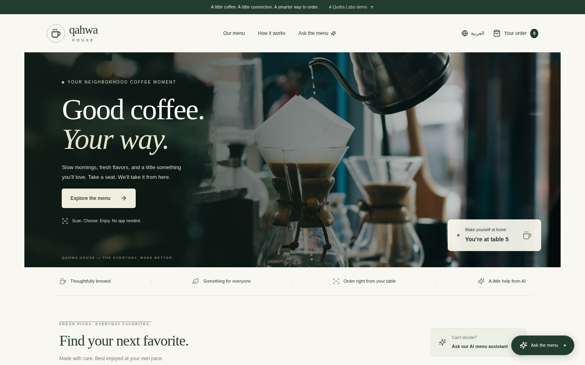
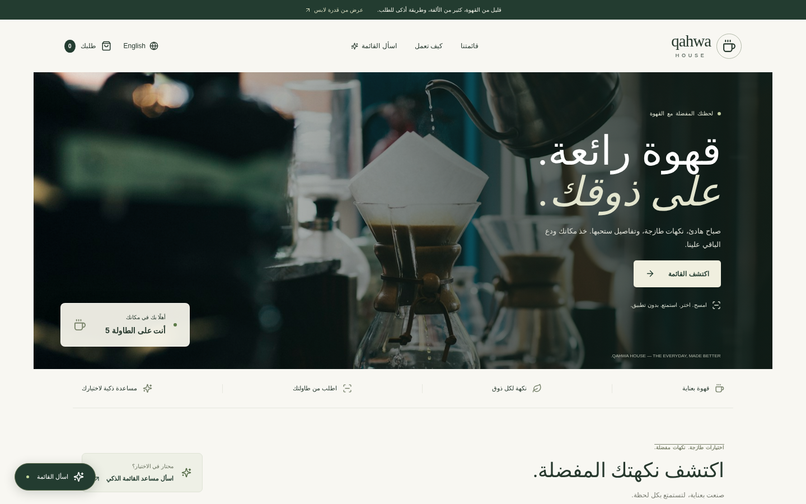
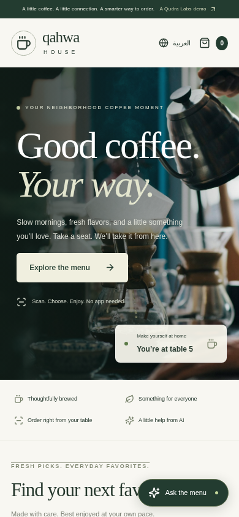

# Qahwa House: AI Menu and QR Table Ordering

Bilingual (EN/AR) cafe menu with QR table ordering and an Ask-the-menu Gemini assistant that recommends dishes.

A demo template by **Maeen Alganimi**. Bilingual English / Arabic (RTL), with AI from Google Gemini (`gemini-2.5-flash`) called server-side only.

| English | Arabic (RTL) | Mobile |
|---|---|---|
|  |  |  |

## Run locally
```bash
npm install
cp .env.example .env.local   # add GEMINI_API_KEY from https://aistudio.google.com/apikey
npm run dev
```
With no `GEMINI_API_KEY` set, the app runs in **Demo mode** with canned AI replies (the screenshots were taken in Demo mode). The business and people shown are fictional.

## Credits
Built from [jonathanrao99/Restaurant-Template](https://github.com/jonathanrao99/Restaurant-Template) (MIT license). The original LICENSE is kept in this repo, and the original README is in `docs/TEMPLATE-README.md`.
